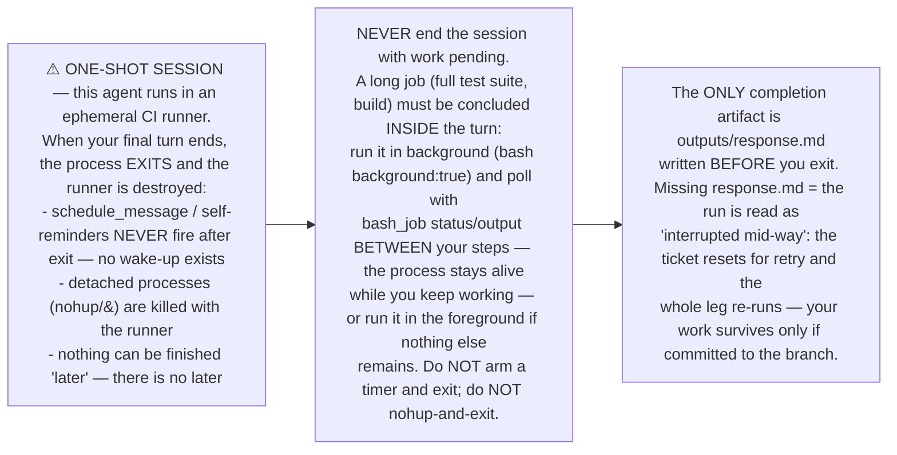

**Why this matters:** if the agent finishes its edits, launches the full test
suite detached (`nohup <test-command> &`), arms a `schedule_message` wake-up
for later, and ends its turn, the process exits code 0, the timer never fires,
and `outputs/response.md` is never written — the leg fails with an
"interrupted mid-way" reset and burns full runs on an already-completed
implementation.
