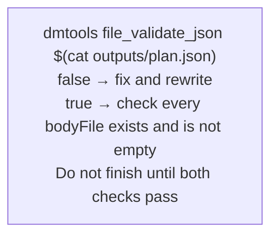

## Output: outputs/plan.json

Write exactly one JSON object. Keep it compact; step descriptions go into separate
Markdown files referenced by path.

Keep the issue whole:

```json
{ "split": false, "reason": "One focused change in the payment module; a single PR is easy to review." }
```

Split it — `children` is the delivery order, 2 steps at least:

```json
{
  "split": true,
  "reason": "Three independently testable deliverables: the data model, the importer, the report.",
  "children": [
    { "title": "Add the order data model and its persistence", "bodyFile": "outputs/plan/step-1.md" },
    { "title": "Import orders from the CSV feed", "bodyFile": "outputs/plan/step-2.md" },
    { "title": "Report daily order totals", "bodyFile": "outputs/plan/step-3.md" }
  ]
}
```

- `split` — `true` or `false`, required.
- `reason` — one or two sentences, required. It is posted on the issue.
- `children[].title` — the title of the step's issue: imperative, specific, under 120 characters.
- `children[].bodyFile` — path of the step's description file. (`body` with inline text is accepted
  but a file is preferred.)
- The project may cap the number of steps (default 8). A plan above the cap is rejected; merge steps instead.

## Output: outputs/plan/step-N.md

One file per step, in the tracker's markup (Markdown for GitHub). Sections:

1. **Goal** — what this step delivers and why, in two or three sentences.
2. **Scope** — what is in this step and, explicitly, what is left to later steps.
3. **Acceptance criteria** — a checklist a reviewer can verify; include the tests the step adds.
4. **Notes** — the modules and files to touch, the earlier steps this one builds on (by step number),
   and any constraint from the parent issue that applies here.

Do not repeat the parent issue in full: the step's issue links to the parent automatically.

## Output: outputs/response.md

A short summary for a human: the decision, the reason, and the list of steps. It is not posted
automatically.

## Validate before finishing


