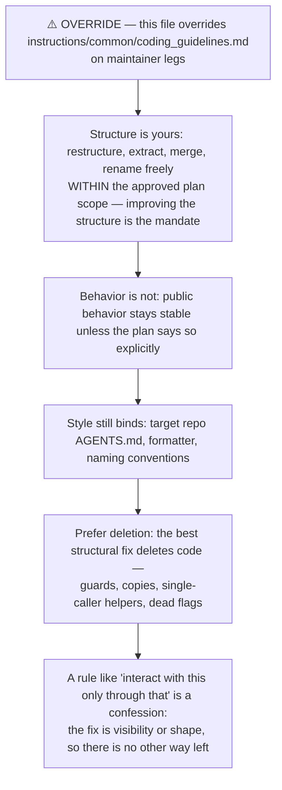

## Why this file exists

The common coding guidelines tell every dev leg to follow the existing
codebase patterns and never invent new ones. That rule is correct for
task-execution legs (surgical, minimal footprint) and wrong for maintainer
legs, whose mandate is structural improvement. On maintainer legs this file
takes precedence where the two disagree:

| Common rule | Maintainer leg |
|---|---|
| "Never invent new patterns when the codebase has an established way" | Applies to behavior and style only. Structure may change if the approved plan says so — that is the job. |
| "Follow existing codebase patterns" | Follow them for untouched code. Restructured code follows the target shape the approved plan defines, then the repo conventions. |

Everything the common file says about conventions, formatting, and
respecting `AGENTS.md` still binds — this override widens the structural
freedom, not the behavioral one.
