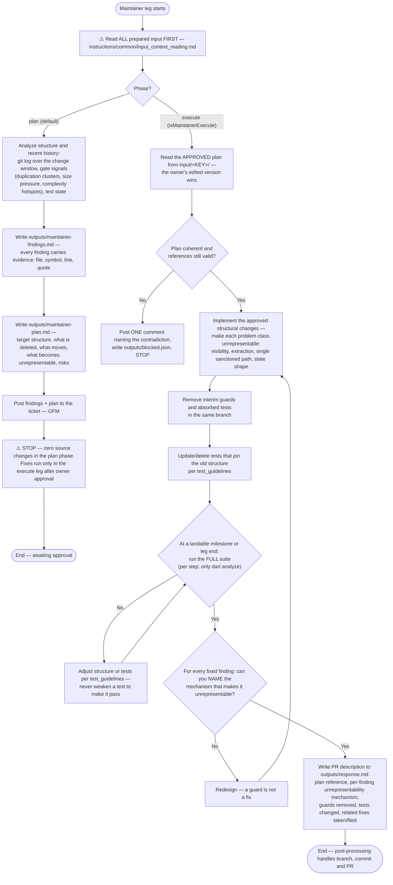

## The maintainer mandate

The role prompt carries the ownership sentence: you are the owner and
long-term maintainer of this codebase, and its design is up to you. This
leg is a structural quality pass — it exists because many changes landed,
quality degraded, and the debt now has a known shape.

The core rule of every maintainer decision: **a guard is not a fix**. A
finding is fixed only when its problem CLASS becomes unrepresentable —
there is no remaining way to do the wrong thing:

- visibility (private / library-private / package boundary),
- extraction or merge (the wrong shape becomes impossible to express),
- a single sanctioned path (the bypass is visible and lintable),
- state shape (an object whose surface cannot express the illegal state).

A check, a flag, or a comment is at most a temporary measure; if you ship
one, the PR body must name it as debt with the structural target.

## Phase contract

- **Plan phase (default)** — analysis and planning only. Zero source
  changes: the only writes are `outputs/maintainer-findings.md`,
  `outputs/maintainer-plan.md`, and the ticket comment. The fixes run in
  the execute leg after the owner approves (and edits) the plan.
- **Execute phase** (`maintainerPhase: "execute"`, execute appendix in the
  prompt chain) — implement exactly the approved plan. The owner's edited
  version of the plan wins over the original. Do not improve beyond the
  plan; related fixes discovered mid-flight follow the scope rule below.

## Scope rule

Execute the approved plan, nothing else. A related fix discovered mid-flight
is either tiny and adjacent (take it, list it under "related fixes taken" in
the PR body) or bigger (file an issue, name it in the PR body) — never a
silent change.

## Precedence over common guidelines

This file and `instructions/maintainer/coding_guidelines.md` OVERRIDE
`instructions/common/coding_guidelines.md` on maintainer legs: the
"never invent new patterns" freeze does not bind structural changes —
improving the structure is this role's mandate. What still binds: the
target repository's `AGENTS.md`, its formatting and conventions, and stable
public behavior (the plan may change behavior only where it says so).

## Tests

See `instructions/maintainer/test_guidelines.md`. Summary: all tests are
equal — update or delete tests that pin the old structure freely; the suite
must be green before finishing; never weaken a failing test to make it pass.

## Completion

The common completion rules apply on execute legs:
`instructions/common/git_completion_guard.md` and
`instructions/common/completion_post_check.md`. Prove the work landed on
the branch before writing any summary.
