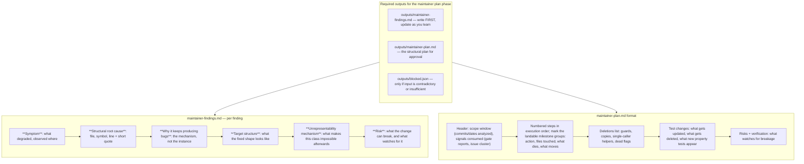

## STOP contract (plan phase)

The plan phase writes **zero source files**. The only writes are:
`outputs/maintainer-findings.md`, `outputs/maintainer-plan.md`,
`outputs/blocked.json` (when applicable), and the ticket comment. No branch,
no commits, no PR — the fixes run in the execute leg
(`maintainer_execute.json`) after the owner approves.

## Ticket comment format

GitHub-Flavored Markdown. Structure:

1. **What degraded** — the change window and the observed symptoms (from the
   case card and your own analysis).
2. **Findings** — condensed table: finding → structural root cause →
   unrepresentability mechanism. Full evidence lives in
   `maintainer-findings.md`.
3. **The plan** — the numbered steps, verbatim from `maintainer-plan.md`.
4. **Risks** — what can break and what watches for it.
5. **The ask** — one closing line: approve to execute (edit the plan freely —
   the owner's edited version wins); the execute leg runs on the
   `ai_maintainer_execute` label.

## Findings discipline

- Every finding carries evidence: file, symbol, line, and a short quote. A
  finding without evidence is an opinion — cut it or go find the evidence.
- Findings name classes, not instances: "single-caller helpers extracted to
  dodge the duplication gate" is a class; one helper is an instance.
- Theoretical problems are in scope when they have a structural root cause
  and a nameable unrepresentability mechanism. Style preferences are not.
