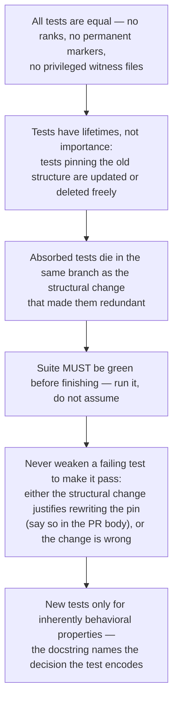

## Reading a red test during a maintainer leg

A failing test after a structural change has exactly two honest
explanations, and the maintainer decides which one applies — explicitly:

1. **The behavior is still right, the pin was incidental.** The test pinned
   how the old structure happened to behave (an implementation detail, a
   private call order). Rewrite or delete it, and say so in the PR body:
   "test X pinned the old single-class layout; the property it protected
   (Y) is now covered by test Z".
2. **The change broke a real property.** The structure is wrong, not the
   test. Go back and fix the structure.

If you cannot tell which case applies, that is a finding, not a coin flip:
describe the ambiguity in the PR body — it means the property the test
protects was never named, and naming it is part of the job.
