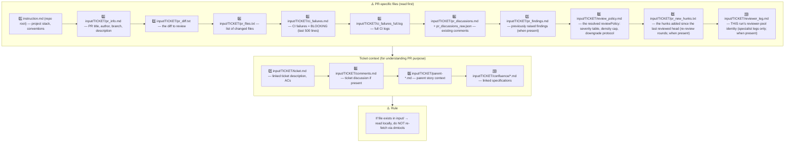

# PR Review Input Context — reading order (base contract, gh-1406)

Reviewer-agnostic: EVERY reviewer leg reads the same PR context. Read files
that exist in `input/` locally — do NOT re-fetch via dmtools.

Read PR files to understand WHAT changed. Read ticket files to understand WHY
it changed and verify against requirements.

## Specialist legs — `reviewer_leg.md` present

When `input/TICKET/reviewer_leg.md` exists, this run is a SPECIALIST leg of
the gh-1406 reviewer pool: it is ONE reviewer's focused pass, not the
posting review. The file names this leg's reviewer, its output contract and
its round. A specialist:

- hunts ONLY its lens's dimension (the lens file assembled around this
  contract names it) — the generalist posting pass owns everything else;
- writes `outputs/pr_review_candidates.json` per the base candidates-only
  contract (output_rules.md) — NEVER `outputs/pr_review.json`, never
  `pr_review_general.md`, never `pr_review_comments/*`;
- posts nothing, labels nothing, changes no status — the machine parses the
  candidates file and stamps the markers.

A leg WITHOUT `reviewer_leg.md` is the posting leg: the full verdict
contract below applies unchanged.

<!-- Pack-reachability anchor: the deprecated v1 instruction shims are listed in instructions/pr_review/deprecated-v1.md (frozen; removed in the next major release). -->
