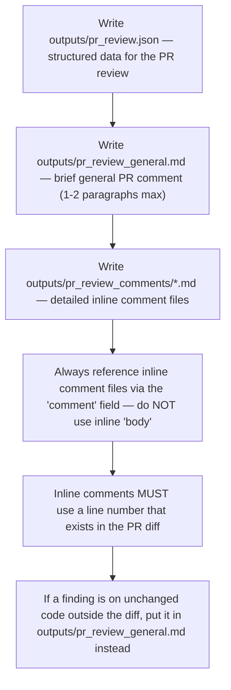

# PR Review Output Rules — the machine contract (base, gh-1406)

Reviewer-agnostic: every reviewer leg writes the same structured review
artifacts; the machine parses them (gh-1350/1351). The lens may add
reviewer-specific files but never changes this contract.

## The contract

- `outputs/pr_review.json` — valid JSON with `recommendation`
  (APPROVE | REQUEST_CHANGES | BLOCK), `summary`, `generalComment`,
  `inlineComments`, `issueCounts`.
- `outputs/pr_review_general.md` — the general PR comment body; max 1-2
  paragraphs, factual, no essays.
- `outputs/pr_review_comments/<name>.md` — one file per detailed inline
  comment; the `comment` field carries the file PATH, never the text itself.
- Each inline comment: `path`, `line`, `startLine`, `side`, `comment`,
  `severity` (BLOCKING | IMPORTANT | SUGGESTION | NIT).
- Inline comments MUST target a line that appears in the PR diff (use line
  numbers from the right-hand side of diff hunks; if `pr_diff.txt` is
  truncated, run `git diff origin/{baseBranch}...HEAD` to locate the exact
  line). A finding on unchanged code outside the diff goes to
  `pr_review_general.md` — never an inline thread.
- If `ci_failures.md` is present → include each failure as 🚨 BLOCKING
  (full logs in `ci_failures_full.log`).
- Keep `summary` under 2 sentences — details live in the inline comment
  files, not the general text.
- Ticket context: verify the PR changes satisfy the ticket ACs — note gaps
  in the review.
- The verdict is a MACHINE decision recomputed from `issueCounts` + the
  resolved `reviewPolicy` — the census is the machine's source of truth;
  keep it accurate.
