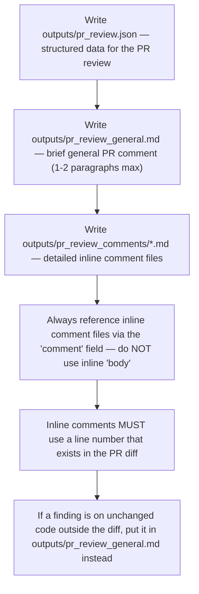

# PR Review Output Rules — the machine contract (base)

Reviewer-agnostic: every reviewer leg writes the same structured review
artifacts; the machine parses them. The lens may add
reviewer-specific files but never changes this contract.



## The contract

- `outputs/pr_review.json` — valid JSON with `recommendation`
  (APPROVE | REQUEST_CHANGES | BLOCK), `summary`, `generalComment`,
  `inlineComments`, `issueCounts`.
- `outputs/pr_review_general.md` — the general PR comment body; max 1-2
  paragraphs, factual, no essays.
- `outputs/pr_review_comments/<name>.md` — one file per detailed inline
  comment; the `comment` field carries the file PATH, never the text itself.
- Each inline comment: `path`, `line`, `startLine`, `side`, `comment`,
  `severity` (BLOCKING | IMPORTANT | SUGGESTION | NIT).
- Inline comments MUST target a line that appears in the PR diff (use line
  numbers from the right-hand side of diff hunks; if `pr_diff.txt` is
  truncated, run `git diff origin/{baseBranch}...HEAD` to locate the exact
  line). A finding on unchanged code outside the diff goes to
  `pr_review_general.md` — never an inline thread.
- If `ci_failures.md` is present → include each failure as 🚨 BLOCKING
  (full logs in `ci_failures_full.log`).
- Keep `summary` under 2 sentences — details live in the inline comment
  files, not the general text.
- Ticket context: verify the PR changes satisfy the ticket ACs — note gaps
  in the review.
- The verdict is a MACHINE decision recomputed from `issueCounts` + the
  resolved `reviewPolicy` — the census is the machine's source of truth;
  keep it accurate.

## The candidates-only contract (pool specialist sessions)

A pool specialist session (its prompt file is
`input/TICKET/pool_specialist-<reviewer>.md` — see input_context.md) writes
ONE file and nothing else:

`outputs/pr_review_candidates-<reviewer>.json`

```json
{
  "reviewer": "<the reviewer name from the prompt>",
  "head": "<the round head sha from the prompt>",
  "candidates": [
    {"id": 1, "path": "src/auth/UserService.js", "line": 45,
     "severity": "BLOCKING", "claim": "one-paragraph statement of the finding"},
    {"id": 2, "path": "docs/arch.md", "line": null,
     "severity": "SUGGESTION", "claim": "a digest candidate — no diff line"}
  ],
  "count": 2,
  "truncated": false,
  "at": "<iso timestamp>"
}
```

- `claim` is the finding's substance: what is wrong, where the evidence
  is, why it matters. No severity header line, no verdict language — the
  tier rides the `severity` field (BLOCKING | IMPORTANT | SUGGESTION |
  NIT) and the machine classifies the posted thread from it.
- `id` numbers the candidates within the file (1..n). `path` is
  repo-relative; `line` is the diff line (right-hand side) or `null` for a
  digest candidate — findings anchored outside the diff are allowed as
  digest candidates, never as invented line numbers.
- Write NOTHING else: no `outputs/pr_review.json`, no
  `pr_review_general.md`, no `pr_review_comments/*`, no `response.md`. Do
  not post, label, resolve threads, or change statuses — the aggregation
  step reads this file and the posting review does all machine
  bookkeeping (the merged census + the marker stamps).
- Severity discipline still applies: raise only what the lens hunt
  justifies; an empty candidates list is a valid answer (the leg completes
  with zero findings).
- The candidates pass the finding filter like every other finding (fresh
  verification, weighted retention for high-weight reviewers) and the
  posting leg merges them into ONE review — a specialist never posts a
  second review.

### The coverage file (the second specialist output — the memory)

Alongside the candidates file the specialist maintains ONE more file:

`outputs/pr_review_coverage-<reviewer>.json`

```json
{
  "reviewer": "<the reviewer name>",
  "head": "<the round head sha>",
  "covered": ["src/auth/UserService.js"],
  "pending": ["docs/arch.md", "src/auth/Session.js"],
  "truncated": false,
  "at": "<iso timestamp>"
}
```

- **Write it FIRST** — before any review: `covered: []`, `pending:` the
  full list of repo files you plan to review (your pass's scope).
- Move files `pending` → `covered` as you finish them (re-write the file).
  The file is re-read by the machine after your session ends, whatever its
  cause — a timeout kills the session but not what landed on disk.
- The NEXT pass receives this file as memory: covered files that the fresh
  hunks do not touch are skipped (unchanged — machine-verified), still-
  pending files are finished first. Big requests converge: every round
  reviews the delta plus the oldest debt, until nothing is pending.
- `truncated: true` near the cap: unfinished files stay `pending` — a
  partial honest record is a valid state, silence is not.
