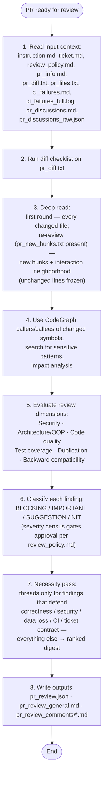
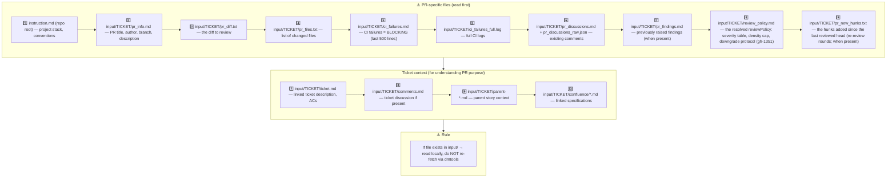

# PR Review General Guidelines

## Review flow



## 1. Input context — MANDATORY reading order



Read PR files to understand WHAT changed. Read ticket files to understand WHY it changed and verify against requirements.

## 2. Diff checklist — apply to `pr_diff.txt`

For every hunk, ask at least these questions:

- [ ] Does the change match the ticket scope? Any scope creep?
- [ ] Are new or changed public APIs contract-safe for existing callers?
- [ ] Is user/external input validated, sanitized, or escaped?
- [ ] Are secrets, tokens, or PATs handled safely — not logged, not interpolated into shell scripts?
- [ ] Are new or modified files present under `testing/` in a non-test-automation PR?
- [ ] Is dead code, unused imports, or obvious duplication introduced?
- [ ] Are error paths handled, or are failures silently swallowed?
- [ ] Are new dependencies justified and compatible with the existing stack?
- [ ] Beyond blockers: does each candidate finding pass the §7 necessity test (defends correctness on a touched path, security, data loss, CI breakage, or the ticket contract) — or is it digest material?

## 3. Changed-file deep read — and frozen already-reviewed code

Do not review from the diff alone.

**First review round** (no `pr_new_hunks.txt` in the input folder) — read the full content of every changed file:

- imports and dependencies
- class/method responsibilities and adherence to SRP / OOP principles
- naming consistency with the rest of the codebase
- error handling, logging, and edge cases
- test coverage for changed behavior
- backward-compatibility and migration impact

**Re-review rounds** (`pr_new_hunks.txt` present — the hunks added since the last reviewed head) — read the full content of the files the new hunks touch plus their interaction neighborhood (direct callers/callees of changed symbols), not whole files. Already-reviewed lines are **frozen**: a finding on an unchanged line is valid only when the new hunks make the problem worse (the interaction test — e.g. a new call path now feeds unvalidated input into old code). Anything else on frozen lines is advisory digest at most (§7), never a thread. If `pr_new_hunks.txt` is absent from a later round (e.g. a force-push the machine could not diff), the whole diff is in scope again.

## 4. Impact analysis (CodeGraph or grep fallback)

Use CodeGraph to find "what could break":

- `codegraph_callers` / `codegraph_callees` on modified public symbols
- `codegraph_search` for: `PAT_TOKEN`, `secrets.`, `github.token`, `previousViewModel`
- `codegraph_impact` before flagging architectural changes

**If CodeGraph unavailable**, use grep and document it:
```bash
grep -rn "changedFunctionName" --include="*.ts" .
grep -rn "secrets\.\|github\.token" .
```

## 5. Review dimensions

Rate the PR across all relevant dimensions:

| Dimension | What to check |
|---|---|
| **Security** | injection, unsafe interpolation, secret leakage, missing permissions, unsafe defaults |
| **Architecture / OOP** | SRP, coupling, abstraction consistency, provider/repository boundaries |
| **Code quality** | naming, complexity, error handling, logging, comments |
| **Tests** | coverage for new/changed paths, meaningful assertions, no brittle string-only tests |
| **Duplication** | copy-paste, duplicated logic across files, duplicated configuration |
| **Backward compatibility** | public API changes, migration paths, default behavior |
| **Performance** | unnecessary rebuilds, heavy sync operations, missing timeouts |
| **Workflow / CI safety** | (when `.github/workflows/` changes) secret declarations, ref pinning, permissions, timeouts |

### Delegate to the measured gates (gh-1404)

Complexity, duplication and style are already measured by the repo's CI — the CRAP ratchet, the duplication gate, lint. The gate is the reviewer of record for those dimensions: a passing gate is not a thread (the cost was already measured and accepted); a failing gate is CI breakage (🚨 BLOCKING). Raise a complexity/duplication/style finding only when no gate covers it **and** the concrete cost is stateable — what breaks or what the next change pays.

## 6. Severity classification

Classify every finding before writing outputs:

- **BLOCKING** — merge would cause a bug, security issue, data loss, or CI break. Must be fixed.
- **IMPORTANT** — real maintainability or correctness issue. Strongly prefer fixing before merge.
- **SUGGESTION** — optional improvement to the documented/behavioral surface (missing docs, unclear contract, better API shape). Does not block merge.
- **NIT** — changes nothing behavioral and nothing documented: style, formatting, naming micro-preferences. Never blocks merge, never triggers a lap.

When in doubt, classify lower and state what evidence would raise the finding one level (the same discipline as the external-spec citation rule below — an unproven claim must not hold a PR hostage).

### Density control — post top-K, digest the overflow (gh-1351)

`review_policy.md` in the input folder carries the resolved policy and its density cap
(`allowed = clamp(round(2 + 3*sqrt(additions/200)), 2, 8)` — 20→3 · 50→4 · 200→5 · 800→8):

- The cap applies to 💡 SUGGESTION / 🪶 NIT threads only — 🚨/⚠️ findings are **never capped** and always post as threads.
- Rank your 💡/🪶 findings by value and post only the top-K as inline threads.
- The overflow becomes a **ranked digest list** in the general comment (one line each: `path:line — finding`).
- The census counts posted threads + digest lines (`issueCounts.suggestions`/`nits` count posts, `digest` counts the overflow lines).
- The machine audits the posted thread count against the cap (warn only — it never fails the leg).

### Downgrade protocol — honor a justified ⚠️→💡 from rework (gh-1351)

A rework lap may downgrade a specific ⚠️ IMPORTANT finding to 💡 SUGGESTION **only with a written
justification in the census** (its thread reply and response summary). When the justification is
present, classify the finding 💡 in this round's census — a false-⚠️ review converges to APPROVE
without a code change. A silent downgrade does not exist: without the written justification, keep
⚠️ IMPORTANT and the cycle repeats.

### External-spec evidence rule

A finding whose core claim is "**the spec / reference / ticket / external tool says or does X**" may be raised at 🚨 **BLOCKING** only when it quotes the exact source the review actually read during this run — a `file:line` reference or a doc URL. A bare "the spec says …" assertion is unfalsifiable for the author and for the machine, and a false one holds a validated PR hostage (for example, a BLOCKING thread claiming an exemption list that the reference source does not contain when the reviewed code is behaviorally identical to it).

Without a verifiable citation:

- **Before emitting a spec-claim finding without a citation, locate the requirement in the ticket and cite it (for example `ticket.md:12`) — an uncited true claim is demoted mechanically.**
- Downgrade the finding to ⚠️ **IMPORTANT**, phrased as a question: "Please confirm against `<source>` — if confirmed, this becomes blocking."
- Never let an uncited spec assertion be the sole reason for `REQUEST_CHANGES`.

The machine applies the same discipline (and a safety net against coin-flip formatting): every uncited spec claim is cross-checked against the ticket text the run already has under `input/`. When the requirement is verifiably present there, the finding keeps 🚨 BLOCKING force and the matched citation is auto-appended; when the ticket contradicts it, lacks it, or the mechanical check is inconclusive, the finding is demoted and stamped `demoted-from-BLOCKING` — the finding-identity registry keeps it re-elevatable in a later round by adding a citation instead of raising the same defect as new.

This is not a strictness cut: a spec-claim finding **with** a verifiable citation keeps full 🚨 BLOCKING force.

## 7. Necessity test — what earns a thread

A thread is expensive: each one costs a rework lap — 15–20 CI minutes — and the rework's own fresh hunks get reviewed again next round. A finding earns a thread only if it **defends** one of:

- correctness on a path the change actually touches
- security
- data loss
- CI breakage
- the ticket contract

Everything else — real, accurate, but not merge-relevant — goes to the **ranked digest list** in the general comment (one line each: `path:line — finding`), never a thread.

- Do not defer SUGGESTION or IMPORTANT items to a later round because a BLOCKING issue exists — classify everything you found; only the necessity test decides thread vs digest.
- The exhaustive pass keeps running (§3 defines its scope). Re-read the in-scope code and ask: *"What else does this change put at risk?"* — not *"What else is improvable here?"*
- Before writing outputs, verify each thread you are about to open passes the necessity test; everything else is already in the digest.

## 8. Outputs

Write the standard review artifacts:

- `outputs/pr_review.json` — structured data with `recommendation`, `summary`, `inlineComments`, `issueCounts`
- `outputs/pr_review_general.md` — 1-2 paragraph general PR comment
- `outputs/pr_review_comments/*.md` — one file per detailed inline comment

**Inline comment lines must be present in the PR diff.** GitHub review threads can only be attached to added or context lines inside a diff hunk. If `pr_diff.txt` is truncated, run `git diff origin/{baseBranch}...HEAD` to locate the correct line numbers. Findings on unchanged code outside the diff belong in `outputs/pr_review_general.md`, not as inline comments.

Do NOT write `outputs/response.md`; the review is posted to GitHub only.

## 9. Previously raised findings — the finding-identity registry

When `input/TICKET/pr_findings.md` is present, earlier review rounds on this PR already raised findings **F1–Fn** (each with its claim, file and status). The registry dedup is what keeps repeated rounds from minting duplicate threads for the same defect.

Answer the registry **before** raising anything new:

- **verify fixed** — the fixing hunk you can cite closes the finding: disposition `"fixed"` with the hunk reference. Never mark `fixed` without a citable hunk.
- **withdraw (reason required)** — the claim is wrong or no longer applies: disposition `"withdrawn"` with the reason. A withdrawal without a reason is rejected by the machine, and BLOCKING withdrawals surface to the owner.
- **mark re-introduced** — the defect is still there (e.g. the fix was reverted): leave the finding open and let your re-raise match it; do not re-litigate the claim from scratch.

New claims always need new evidence, and they pass the same §7 necessity test before they earn a thread. A finding on the registry list is answered, not re-raised as if it were news.

**Candidates pending confirmation** (also listed in `pr_findings.md`): when a new finding you raised is *possibly same as F<n>*, the machine asks one word per candidate — confirm with `"same as F<n>"` or call it `"new"`. Unconfirmed candidates become new identities; nothing merges without your confirmation. This is a dedup request, not a push-back: confirming merges the threads, it does not weaken the finding (merges can only escalate severity, never de-escalate).

Add a `findingReview` block to `outputs/pr_review.json` (alongside `inlineComments`):

```json
{"findingReview": {
  "dispositions": [
    {"n": 1, "status": "fixed", "hunk": "src/auth.ts:40-48 — try/catch added"},
    {"n": 2, "status": "withdrawn", "reason": "validation exists at src/auth.ts:50 — claim was wrong"},
    {"n": 3, "status": "re-introduced"}
  ],
  "confirmations": [
    {"proposedFor": 1, "same": true}
  ]
}}
```

When `pr_findings.md` is absent, this section does not apply — review exactly as before.
