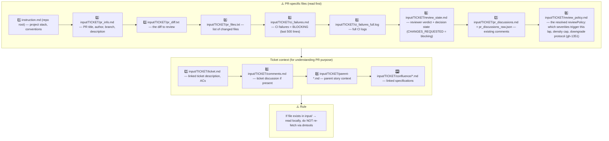

```mermaid
flowchart TD
    START([Ticket enters rework]) --> SETUP{rework_setup_failed.md exists?}
    SETUP -->|Yes| FAIL[Write setup failure response and stop]
    SETUP -->|No| INPUT[Read ALL input files in the ticket subfolder]
    INPUT --> INPUTS["request.md, comments.md, existing_questions.json, parent_context_*.md, review_policy.md, pr_info.md, pr_diff.txt, merge_conflicts.md, ci_failures.md, ci_failures_full.log, review_state.md, pr_discussions.md, pr_discussions_raw.json"]
    INPUTS --> CONFLICTS{merge_conflicts.md exists?}
    CONFLICTS -->|Yes| RESOLVE["Resolve every conflict marker, git add each file, verify with git diff --check"]
    CONFLICTS -->|No| CI
    RESOLVE --> CI{ci_failures.md or ci_failures_full.log exists?}
    CI -->|Yes| OWNED{"Violations you must fix (N owned) table at the top?"}
    OWNED -->|Yes| FIX_OWNED["Fix EVERY owned violation (path:line, rule, measured vs limit)<br/>— an owned violation may NOT be dismissed as unrelated/<br/>not caused by this PR/infra; dispute per item with disputed: &lt;reason&gt; only<br/>when the gate itself is wrong"]
    OWNED -->|No| FIX_CI["Fix CI root cause: dependencies, config, or test setup"]
    FIX_OWNED --> THREADS
    FIX_CI --> THREADS[Address every open thread in pr_discussions.md]
    THREADS --> BLOCKING{BLOCKING issues?}
    BLOCKING -->|Yes| FIX_BLOCK["Fix BLOCKING first — security, critical bugs"]
    FIX_BLOCK --> IMPORTANT
    BLOCKING -->|No| IMPORTANT[Fix IMPORTANT issues]
    IMPORTANT --> SUGGESTIONS{Minor suggestions?}
    SUGGESTIONS -->|Yes| SKIP["Skip if time-consuming — note in response.md"]
    SUGGESTIONS -->|No| TEST["Follow TDD approach for every fix — see the TDD approach section included later in this prompt — then run tests and verify"]
    SKIP --> TEST
    TEST --> OUTPUT[Write outputs/response.md]
    OUTPUT --> REPLIES{Open review threads?}
    REPLIES -->|Yes| REVIEW_REPLIES["Write outputs/review_replies.json with one reply per open thread using threadId + inReplyToId"]
    REPLIES -->|No| END([End])
    REVIEW_REPLIES --> END
```

## 1. Input context — MANDATORY reading order

Read PR files to understand WHAT changed. Read ticket files to understand WHY it changed and verify the rework addresses all ACs.

## 2. Owned CI violations — no dismissal

`ci_failures.md` opens with machine-extracted violation tables:

- **"Violations you must fix (N owned)"** — each row (`check`, `rule`, `path:line`, measured-vs-limit) is in a file changed by this PR's diff. Owned = blocking. Fix it, or dispute it **per item** with `disputed: <reason>` when the gate itself is wrong.
- **"Foreign / infra reds (do not chase)"** — reds in files this PR does not touch. Do not fix them here; mention them in the summary.

The full uncapped list lives in `ci_violations.json`. In `outputs/response.md`, **list every owned violation with `fixed` or `disputed: <reason>`**. A summary that claims the reds are "not caused by this PR" / "unrelated" / "infra" while owned violations are open is mechanically rejected: the leg fails and the no-op loop guard counts the lap.

For `dart_format` owned items (rule `dart_format` — the `static` job failed on `dart format --set-exit-if-changed`), the expected fix is `dart format .` on the whole tree, then verify with `dart format --set-exit-if-changed --output=none .` before pushing.

## 3. Already-addressed / invalid threads (audit-resolve)

The thread list in `pr_discussions.md` / `pr_discussions_raw.json` comes from the SAME GraphQL reviewThreads census the SM armer counts — if it lists threads, they are really open on GitHub and each one needs exactly one reply entry in `outputs/review_replies.json`.

A reply entry does NOT always imply a code commit:

- **Already addressed** — verify against the current head; cite the commit/file/line that covers the finding.
- **Invalid finding** — explain precisely why it does not apply to this code.

When every open thread has a targeted reply and the pass pushed no commits, the post-action resolves the threads with an explanatory audit line (rework run URL) per thread — this is the ONLY permitted resolution-without-changes path. Partial coverage resolves NOTHING: the pass is reported blocked. Never leave an open thread without a reply entry.

## 4. Downgrade protocol — ⚠️→💡 only with a written justification (gh-1351)

`review_policy.md` carries the resolved severity table: the tiers whose round is `rework` gate approval and trigger this lap; polish/none tiers do not. Fix in that order (🚨 first, then ⚠️).

You may downgrade a **specific** ⚠️ IMPORTANT finding to 💡 SUGGESTION **only when you write the justification into the census** — both the thread reply and the response summary must state why the finding is NOT real maintainability debt (e.g. the guarded condition is unreachable, the contract is documented elsewhere, the risk is structurally impossible). The next review round honors a justified downgrade: the finding counts 💡 and the cycle converges to APPROVE **without a code change**.

- A silent downgrade does not exist — without the written justification the finding stays ⚠️ and the review re-raises it, repeating the loop.
- Downgrade the finding, not the conversation: still reply to the thread (the reply IS the justification carrier).
- Never downgrade 🚨 BLOCKING — only the reviewer (or the project `reviewPolicy` config) can weaken a blocking finding.

## 5. Opportunistic pickup — cheap 💡/🪶 ride the lap (gh-1352)

While the lap fixes its mandatory set (🚨/⚠️), pick up the cheap findings you pass anyway:

- **Eligible:** 💡 SUGGESTION / 🪶 NIT findings in the SAME files your mandatory fixes already touch — you are in the file, the change is doc/test-trivial, and the lap budget allows it: `review_policy.md` carries `opportunisticMaxThreads` (default 8) and `opportunisticSameFilesOnly` (default true). Stay inside both.
- **Not eligible (leave for triage):** findings in files the mandatory set does not touch, findings needing >trivial edits, and anything non-local to this PR's diff. Skipping them is correct — the machine triage closes non-picked threads with `wontfix`/`deferred` dispositions after the lap lands; do NOT force-fix them here.
- **Bookkeeping:** every picked-up thread still gets its `outputs/review_replies.json` entry; name the fixing commit in the reply so the machine can close it as `fixed: <ref>`. Threads you did not pick up need no reply — triage owns them.

## 6. Surgical Scope Guard — never rewrite approved code outside the findings

In `pr_rework`, you are modifying an existing PR that has already been implemented and reviewed:

- **Modify ONLY** the files and code regions directly required to resolve:
  1. Open review threads (`pr_discussions.md` / `pr_discussions_raw.json`),
  2. Merge conflicts (`merge_conflicts.md`), or
  3. Owned CI failures (`ci_failures.md` / `ci_violations.json`).
- **DO NOT** refactor, reformat, rename, reorganize imports, or rewrite untouched/already-approved parts of the PR diff (even if your session started fresh without prior history).
- Keep the rework commit diff minimal and strictly scoped to the open findings so reviewers can verify each fix in isolation.
