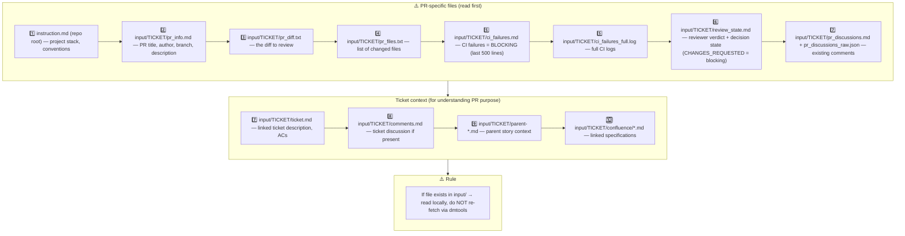

```mermaid
flowchart TD
    START([Ticket enters rework]) --> SETUP{rework_setup_failed.md exists?}
    SETUP -->|Yes| FAIL[Write setup failure response and stop]
    SETUP -->|No| INPUT[Read ALL input files in the ticket subfolder]
    INPUT --> INPUTS["request.md, comments.md, existing_questions.json, parent_context_*.md, pr_info.md, pr_diff.txt, merge_conflicts.md, ci_failures.md, ci_failures_full.log, review_state.md, pr_discussions.md, pr_discussions_raw.json"]
    INPUTS --> CONFLICTS{merge_conflicts.md exists?}
    CONFLICTS -->|Yes| RESOLVE["Resolve every conflict marker, git add each file, verify with git diff --check"]
    CONFLICTS -->|No| CI
    RESOLVE --> CI{ci_failures.md or ci_failures_full.log exists?}
    CI -->|Yes| OWNED{"Violations you must fix (N owned) table at the top?"}
    OWNED -->|Yes| FIX_OWNED["Fix EVERY owned violation (path:line, rule, measured vs limit)<br/>— an owned violation may NOT be dismissed as unrelated/<br/>not caused by this PR/infra; dispute per item with disputed: &lt;reason&gt; only<br/>when the gate itself is wrong"]
    OWNED -->|No| FIX_CI["Fix CI root cause: dependencies, config, or test setup"]
    FIX_OWNED --> THREADS
    FIX_CI --> THREADS[Address every open thread in pr_discussions.md]
    THREADS --> BLOCKING{BLOCKING issues?}
    BLOCKING -->|Yes| FIX_BLOCK["Fix BLOCKING first — security, critical bugs"]
    FIX_BLOCK --> IMPORTANT
    BLOCKING -->|No| IMPORTANT[Fix IMPORTANT issues]
    IMPORTANT --> SUGGESTIONS{Minor suggestions?}
    SUGGESTIONS -->|Yes| SKIP["Skip if time-consuming — note in response.md"]
    SUGGESTIONS -->|No| TEST["Follow TDD approach for every fix — see tdd_approach.md — then run tests and verify"]
    SKIP --> TEST
    TEST --> OUTPUT[Write outputs/response.md]
    OUTPUT --> REPLIES{Open review threads?}
    REPLIES -->|Yes| REVIEW_REPLIES["Write outputs/review_replies.json with one reply per open thread using threadId + inReplyToId"]
    REPLIES -->|No| END([End])
    REVIEW_REPLIES --> END
```

## 1. Input context — MANDATORY reading order

Read PR files to understand WHAT changed. Read ticket files to understand WHY it changed and verify the rework addresses all ACs.

## 2. Owned CI violations — no dismissal (gh-1119)

`ci_failures.md` opens with machine-extracted violation tables:

- **"Violations you must fix (N owned)"** — each row (`check`, `rule`, `path:line`, measured-vs-limit) is in a file changed by this PR's diff. Owned = blocking. Fix it, or dispute it **per item** with `disputed: <reason>` when the gate itself is wrong.
- **"Foreign / infra reds (do not chase)"** — reds in files this PR does not touch. Do not fix them here; mention them in the summary.

The full uncapped list lives in `ci_violations.json`. In `outputs/response.md`, **list every owned violation with `fixed` or `disputed: <reason>`**. A summary that claims the reds are "not caused by this PR" / "unrelated" / "infra" while owned violations are open is mechanically rejected: the leg fails and the no-op loop guard counts the lap.

## 3. Already-addressed / invalid threads (gh-957 audit-resolve)

The thread list in `pr_discussions.md` / `pr_discussions_raw.json` comes from the SAME GraphQL reviewThreads census the SM armer counts (gh-957) — if it lists threads, they are really open on GitHub and each one needs exactly one reply entry in `outputs/review_replies.json`.

A reply entry does NOT always imply a code commit:

- **Already addressed** — verify against the current head; cite the commit/file/line that covers the finding.
- **Invalid finding** — explain precisely why it does not apply to this code.

When every open thread has a targeted reply and the pass pushed no commits, the post-action resolves the threads with an explanatory audit line (rework run URL) per thread — this is the ONLY permitted resolution-without-changes path. Partial coverage resolves NOTHING: the pass is reported blocked. Never leave an open thread without a reply entry.
