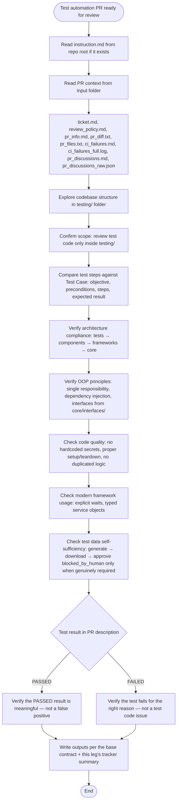

## Outputs (this leg's specifics on top of the base contract)

The reviewer-agnostic output contract (`outputs/pr_review.json`,
`outputs/pr_review_general.md`, `outputs/pr_review_comments/*.md`, inline
anchoring) lives in `instructions/pr_review/base/` and is assembled around
this lens. This leg adds its own tracker-facing summary:

- **Write `outputs/response.md`** — concise tracker-agnostic Markdown
  summary, under 20 lines, bullet-focused. Required sections: Summary,
  Correctness, Architecture, Code Quality, Framework Usage, Test Data,
  Recommendation.
- Tracker-specific formatting is injected via `cliPromptsByTracker` — do
  NOT hardcode Jira/ADO markup in `response.md`.
- If `pr_discussions.md` is present → include `resolvedThreadIds` in
  `outputs/pr_review.json`.
