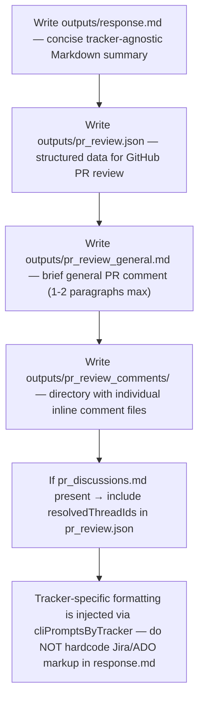

<!-- ⚠️ DEPRECATED v1 shim — frozen content, REMOVED in the next major release. -->
<!-- Live version(s): instructions/pr_review/base/output_rules.md — update your .dmtools/config.js (cliPrompts / cliPromptOverrides)
<!-- or .dmtools/runners/*.json to pin the new path. Content below is kept verbatim so configs
<!-- pinning this old path keep working during the deprecation window.

