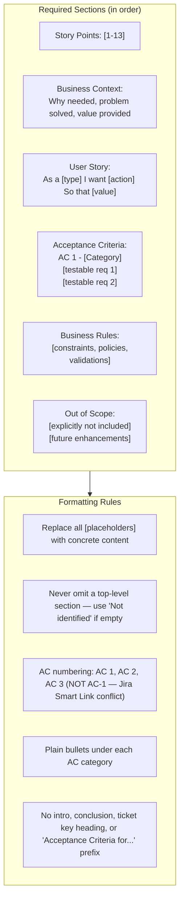

# Enhanced Story Template Guidelines

Follow `agents/instructions/common/markup_placeholder_rules.md` to transform every template placeholder tag into the target tracker markup.

**IMPORTANT**: Read `input/existing_questions.json` for answered questions as context. Use `dmtools` CLI commands for full ticket details.

**IMPORTANT**: Check child tickets and parent story for better context using the appropriate `dmtools` search command.
