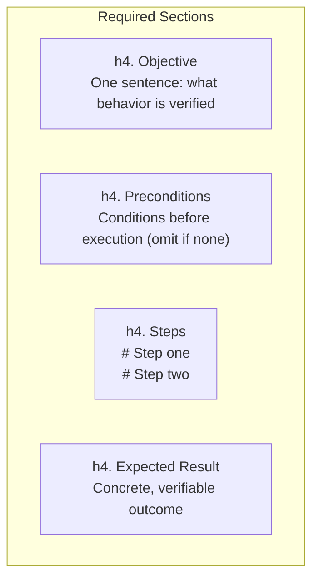
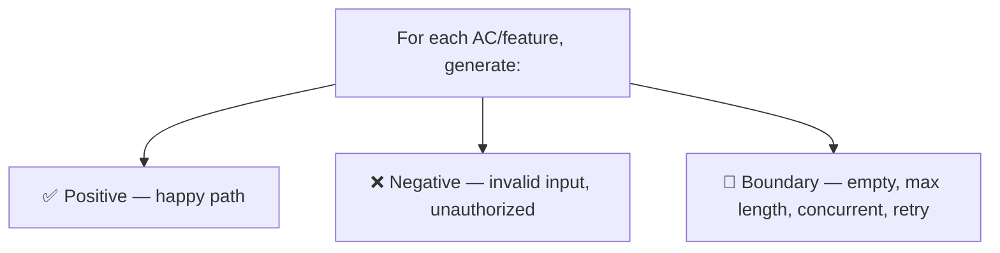
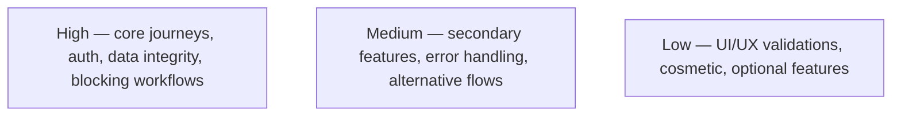
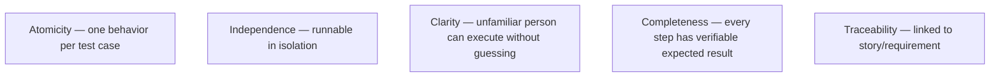
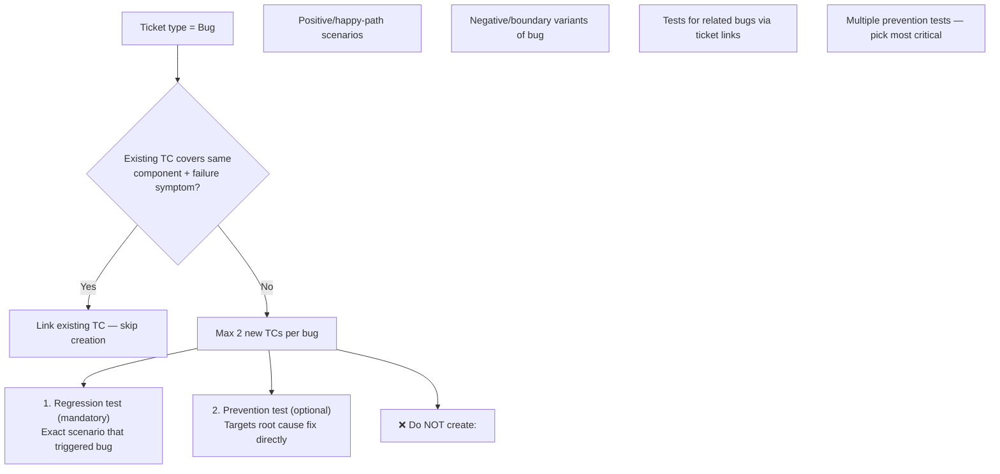
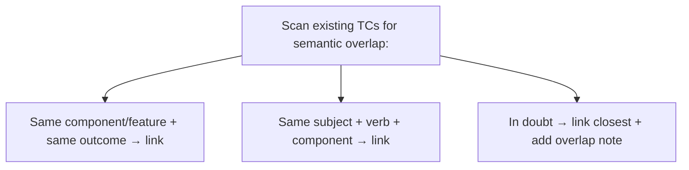

# Test Case Creation Rules

## Naming

Format: *Test: [Action or Feature] — [Expected Outcome]*

Examples:
- Test: Create Jira ticket via AI agent — ticket created with correct fields
- Test: Run agent with WIP label present — processing skipped, comment posted

## Structure

## Coverage

## Priority

## Quality Rules

## Scope

Cover:
- All acceptance criteria in the story
- Main integration points (tracker, SCM, AI providers)
- Error handling and failure scenarios
- Security-relevant behaviors (permissions, tokens, unauthorized access)

## Bug Test Cases — Strict Limits

### Role stamping (gh-1329 — mandatory for bug TCs)

Every Test Case generated for a Bug carries its role in the description, so the
automation pipeline can attribute failures before bouncing the bug:

- The mandatory regression test (the bug's acceptance oracle) must state on its
  first description line: `Verifies: <BUG-KEY>` — the key of the bug it pins.
- A prevention test must state `Regression guard: <scope>` — the pinned behavior
  it protects (and `Verifies: <BUG-KEY>` when the pinned behavior belongs to a
  DIFFERENT bug; the pipeline then treats it as that bug's sibling).
- The bug's verdict is gated only by its own oracle TC; guard and sibling
  failures are triaged mechanically (retry → fingerprint → differential rerun)
  and route to the TC maintenance ledger instead of bouncing the bug.

## Deduplication (mandatory before creating)

