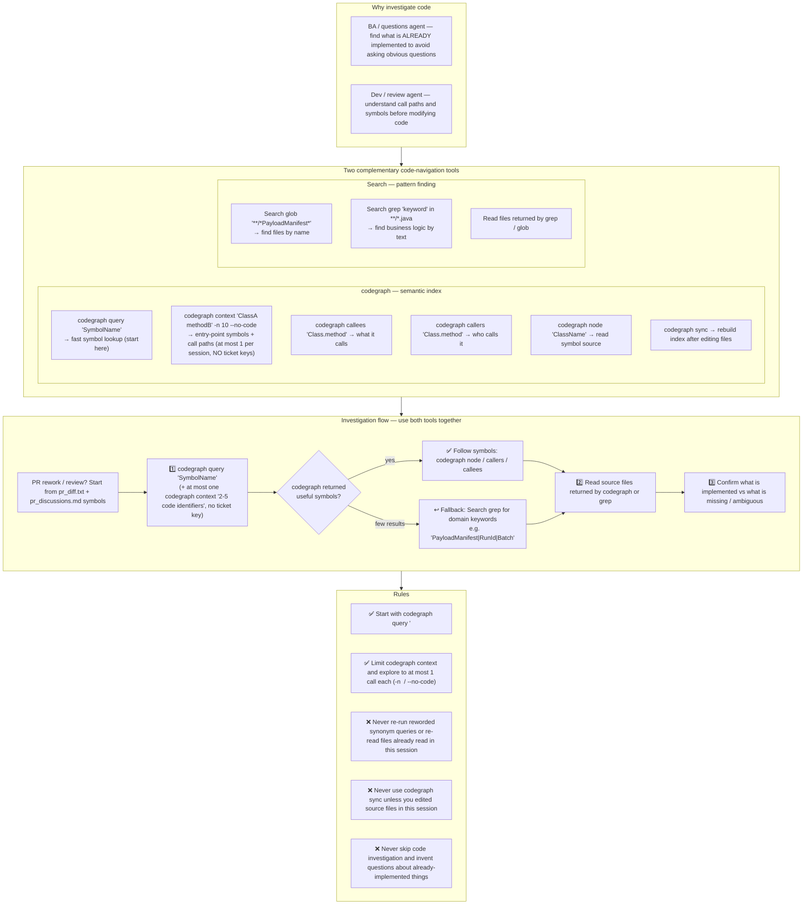

**HARD GATE — read before any tool call:**

1. **Never put ticket keys or process words (`PR rework`, `bug fix`, `test automation`) into CodeGraph queries.** Use 2–5 concrete code identifiers (class, method, table, endpoint, flag, or package) extracted from the ticket, PR diff, or review comments.
2. **Start cheap:** begin code investigation with `codegraph query "<SymbolName>"` (sub-second symbol search). Follow with **at most one** `codegraph context "<2-5 code identifiers>"` (and at most one `codegraph explore` per session); on large indexes pass `-n <max-nodes>` or `--no-code` when only structure is needed, then narrow with `codegraph node`, `codegraph callers`, and `codegraph callees`.
3. **PR rework and PR review agents:** start from the PR's changed files (`pr_diff.txt`) and review comments (`pr_discussions.md`), then run `codegraph query` / `node` / `callers` / `callees` on the touched symbols — never open with a blind `codegraph context` on the ticket key.
4. Keep a running mental list of files you have already read and queries you have already run. **Never re-read a file or re-run reworded synonym queries** — quote your earlier finding instead, or fall back to targeted `grep` / `glob` searches with a specific goal.

