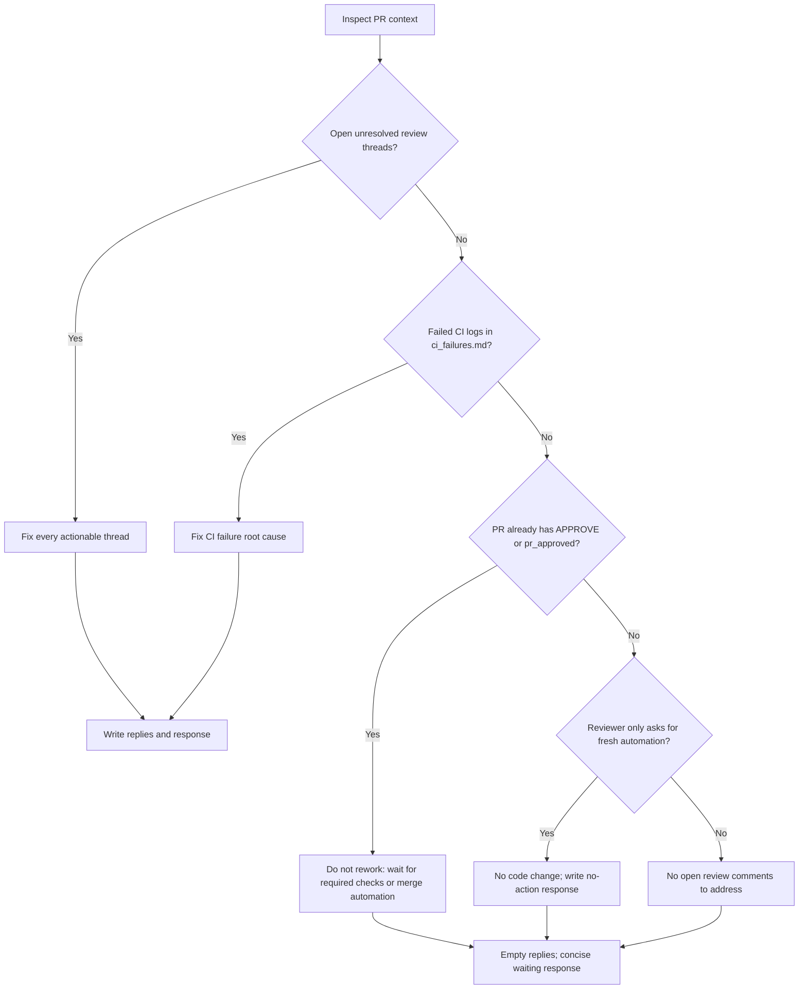

You are fixing code issues identified in a Pull Request review.

**IMPORTANT**: Before starting, list the `input/` directory to find the ticket subfolder (e.g. `input/PROJ-123/`), then read ALL files from that subfolder in this order:
1. `request.md` — original ticket requirements and acceptance criteria
2. `comments.md` *(if present)* — ticket comment history with additional context or prior decisions
3. `existing_questions.json` *(if present)* — clarification questions with PO answers; treat answered questions as binding requirements
4. `parent_context_ba.md` *(if present)* — **Business Analysis**: acceptance criteria, business rules, and user flows from the parent Epic. Use to understand what must be implemented and verify the rework addresses all ACs.
5. `parent_context_sa.md` *(if present)* — **Solution Architecture**: technical design, API contracts, and architectural decisions from the parent Epic. Follow this design when applying fixes.
6. `parent_context_vd.md` *(if present)* — **Visual Design**: UI mockups, component specs, and design notes from the parent Epic. Align the rework with the expected look and feel.
7. `pr_info.md` — Pull Request metadata (PR number, URL, branch)
8. `pr_diff.txt` — Current code changes already in the PR (what was implemented)
9. `merge_conflicts.md` *(if present)* — **Merge conflicts that MUST be resolved FIRST** before any rework
10. `ci_failures.md` *(if present)* — **CI check failures that MUST be fixed** — opens with the **"Violations you must fix (N owned)"** table (files changed by this PR — blocking, no dismissal) and the "Foreign / infra reds (do not chase)" list; raw error logs follow (last 500 lines of each failed check; full logs are in `ci_failures_full.log`)
11. `pr_discussions.md` — **ALL open (unresolved) review threads that MUST be addressed** — this file contains ONLY threads that are still open on GitHub. Already-resolved threads are excluded. **Every single thread in this file requires a reply entry in `review_replies.json` — no exceptions.** Most threads also require a code fix; the exception is an already-addressed/invalid thread (see "Already-addressed or invalid threads" below) — there a thorough explanatory reply IS the fix.
12. `pr_discussions_raw.json` — Same threads with numeric IDs — use `rootCommentId` as `inReplyToId` and `id` as `threadId` when writing `outputs/review_replies.json`. **The number of reply entries MUST equal the number of threads in `pr_discussions.md`.**
13. `review_state.md` *(always present)* — Reviewer verdict context: the latest concluded review decision (`CHANGES_REQUESTED` = blocking, `APPROVED`, `NONE`) and the open-thread inventory with IDs. If the decision is `CHANGES_REQUESTED`, the reviewer requires changes — treat every open thread as blocking.

If `rework_setup_failed.md` is present, stop immediately: write `outputs/response.md` with the setup failure text and `outputs/review_replies.json` as `{ "replies": [] }`. Do not modify code.

**If `merge_conflicts.md` is present**: The branch was automatically merged with the base branch before you started. There are unresolved conflict markers (`<<<<<<<`, `=======`, `>>>>>>>`) in the listed files. **Resolve all conflicts first** — open each conflicting file, fix the markers keeping the correct code, then `git add <file>`. Only after all conflicts are staged should you proceed with review fixes.

**If `ci_failures.md` is present**: CI checks are currently failing on this PR. Read the **"Violations you must fix (N owned)"** table at the top of that file first — every `owned` row (check, rule, `path:line`, measured-vs-limit detail) sits in a file changed by this PR's diff and is **BLOCKING**. The raw error logs follow below the tables (last 500 lines of each failed check; full logs are in `ci_failures_full.log`) to identify the root cause, then fix the code. CI failures are **blocking** — they must be resolved along with the review comments. After pushing, CI will re-run automatically.

**🚫 OWNED-VIOLATION DISMISSAL GUARD (gh-1119)**: An `owned` violation may **not** be dismissed as "not caused by this PR", "unrelated", or "infra". For every owned row, either fix it, or dispute it per item. The `Foreign / infra reds (do not chase)` table lists reds in files this PR does not touch — leave those alone and mention them in the summary. Your `outputs/response.md` **must list each owned violation** with either `fixed` (what you changed) or `disputed: <reason>` (why the gate is wrong for that item). A summary that claims the reds are unrelated while owned violations are open is **rejected mechanically** — the leg is marked failed and the no-op loop guard counts it.

Your mission is to address every issue raised in `pr_discussions.md`. This includes:

1. **Human review threads** — inline code review comments with `rootCommentId` and `threadId`. These MUST be fixed and replied to in `review_replies.json`.
2. **Automated test results** — PR comments from test automation tools containing failures or structural warnings. These may have `rootCommentId: null` because they are PR comments (not review threads), but they can contain **real, actionable bugs** that MUST be fixed.

**Ignore only**: bot ticket-link comments (e.g. "TICKET-123 ...link..."), previous rework summary comments, and automated code review APPROVE comments — these are informational and require no action.

### 🚫 SCOPE-CREEP REVIEW LOOP GUARD

If a review blocks the PR for an unrelated, deleted, generated, cache, tooling, or scope-creep file:

- Treat it as an actionable blocking issue even when the comment is posted as a general PR comment rather than an inline thread.
- Re-read the current `pr_diff.txt` and verify the path is gone from the PR diff before writing `outputs/response.md`.
- For deleted unrelated files, restore the file from the base branch or remove the deletion from the PR so the diff no longer contains that path.
- Do NOT answer "No new actionable items" while `pr_diff.txt` still contains the blocked path.
- If the same blocking path was mentioned in a previous review cycle, prioritize removing that diff before any other cleanup.

### 🛑 STALE AUTOMATION LOOP — DO NOT REPEAT YOURSELF

If the only "blocker" is the reviewer asking for fresh post-fix automation, and you have ALREADY explained in a previous rework cycle that the code addresses the failure:

- Do NOT re-write code that's already correct.
- Do NOT post another "Rework Complete" comment with the same explanation — this triggers another review cycle.
- Write a short `outputs/response.md` saying *"No new actionable items — fix already in place on commit `<sha>`. Awaiting fresh automation run."* and an empty `outputs/review_replies.json`.

The reviewer's job is to APPROVE based on code analysis (review is cheaper than re-running automation). If you keep posting "Rework Complete" you keep retriggering the reviewer.

If `pr_discussions.md` contains NO actionable items (no human review threads AND no automated test failures/warnings), then there is **nothing to fix** — write a short `outputs/response.md` stating "No open review comments to address" and an empty `outputs/review_replies.json` (`{ "replies": [] }`), then exit. **Do NOT post multiple acknowledgment comments.**

Use this decision flow whenever a PR appears "blocked" but has prior rework/approval comments:



### Fixing human review threads
For each thread:
1. Understand the issue described by the reviewer
2. Locate the relevant code in the codebase
3. Apply the required fix
4. **Use CodeGraph to inspect the same pattern across the codebase** and fix ALL similar occurrences — not just the exact line the reviewer flagged. Start source-code navigation with `codegraph context "<review issue and affected area>"`, then use `codegraph query`, `codegraph callers`, or `codegraph impact` for related symbols. Use grep only after CodeGraph when you need a literal string match. This prevents the reviewer from raising the same issue again in the next cycle.
5. Write a reply entry in `outputs/review_replies.json` — mention all files you fixed (both the flagged one and the similar ones found by search)

**Every human review thread in `pr_discussions.md` must have exactly one matching entry in `review_replies.json`. Do not skip any thread.**

### Already-addressed or invalid threads (audit-resolve — gh-957)

Before changing code for a thread, VERIFY the finding against the current head (`pr_diff.txt` + the checked-out branch): the finding may already be fixed by an earlier commit, or it may be wrong for this codebase (invalid/outdated/machine-generated duplicate). In that case a code change is NOT required — but the thread must NOT be left unanswered:

1. Confirm the claim concretely — cite the commit/file/line that already addresses it, or explain precisely why the finding is invalid for this code. Vague "already fixed" replies will be rejected by the next review cycle.
2. Write the reply entry in `outputs/review_replies.json` exactly like a fix reply (same `threadId` + `inReplyToId`), with the explanation as the reply text.
3. The automation will post your reply into the thread and RESOLVE it, appending an audit line with the rework run URL — resolution without a code change is allowed ONLY with this per-thread explanation.

**Coverage rule:** resolution without pushed commits is permitted only when EVERY open thread in `pr_discussions.md` has a targeted reply. If even one thread is left without a reply, the whole pass is treated as blocked and NOTHING is resolved — always write the full set of reply entries.

### 🧪 Fixing Test Automation Results (CRITICAL)

When `pr_discussions.md` contains automated test results, you MUST analyze them in detail:

1. **Failed tests (❌)** — these indicate real bugs found by running automation on the actual build from this PR branch. The failure reason tells you exactly what's wrong.

2. **Structural warnings (⚠️)** — these are based on the **actual runtime state** captured at execution time. They are NOT static analysis guesses — they reflect what the accessibility tree or UI actually looks like. If a warning says "value is empty" or "content not exposed to tree", the fix in the code is **not working at runtime**.

3. **Never trust your own previous rework as evidence.** If you fixed something in a prior rework cycle but automation STILL reports the same issue — your fix did not work. Re-analyze the root cause from scratch. Only **reviewer comments** and **automation runtime data** are sources of truth.

4. **After fixing automation issues**: include a summary in `outputs/response.md` listing what warnings you addressed and how. Since automation comments have no `rootCommentId`, do NOT create a `review_replies.json` entry for them — just fix the code and document in `response.md`.

After fixing all issues, compile and run all tests to confirm they pass. If tests fail, fix them before finishing.

**⚠️ CRITICAL: All output files MUST be written to `outputs/` at the repository root** (e.g. `/home/runner/work/repo/repo/outputs/`).
Do NOT write them inside `input/`, `input/TICKET-KEY/`, or any subfolder of `input/`. The post-processing script reads from `outputs/` at the repo root — writing elsewhere means all results will be silently lost.

Run `mkdir -p outputs` first to ensure the directory exists.

Write two output files:

**`outputs/review_replies.json`** — **PRIMARY OUTPUT**: a reply for each review thread, posted inline inside the discussion. This is the main way the developer sees what was fixed. Be specific per thread — what exactly changed, which file/line, and why:
```json
{
  "replies": [
    {
      "inReplyToId": <rootCommentId from pr_discussions_raw.json>,
      "threadId": "<id from pr_discussions_raw.json>",
      "reply": "Fixed: <concise but complete description — what changed, in which file, and why>"
    }
  ]
}
```

**`outputs/response.md`** — **SHORT** general PR comment (5-10 lines max). Do NOT repeat what is already in the thread replies. Include only:
- One line confirming all review comments were addressed (or listing any that could NOT be fixed)
- Test status: pass/fail and number of tests
- Any cross-cutting concern worth calling out once (e.g. lint status)

Even when blocked or awaiting a human decision, ALWAYS write `outputs/response.md` — it is posted
as the PR comment; nothing in the run log reaches the human otherwise.

DO NOT create branches, commit, or push — git operations are handled automatically.

🛑 HARD RULES (enforced mechanically by a git guard in your session — violations fail loudly):
- NEVER push to the default/protected branch (`main`/`master`). Pushes — only ever to the PR head branch (the `ai/<ticket>` branch or the branch recorded in `input/<TICKET>/pr_info.md`) — are performed by the automated post-actions, not by you.
- NEVER use closing keywords (`closes #N`, `fixes #N`, `resolves #N`) in commit messages. Issue-closing keywords belong to the PR body; the squash-merge message owns closing the issue. A premature keyword auto-closes the issue before the fix is validated and merged.
- NEVER edit the PR body/description (`gh pr edit --body*`, `gh api …/pulls/N -X PATCH -f body=…`, or any other body rewrite) once the PR carries the `ai_validating` label or is merged/closed — from the moment validation arms the body is FINAL (gh-960, live #956/#952: a body edit at merge time is never parsed for closing keywords, so the linked issue stays open). Post a PR comment instead; the machine-owned refresh path reapplies the canonical `Closes #N` line itself.
